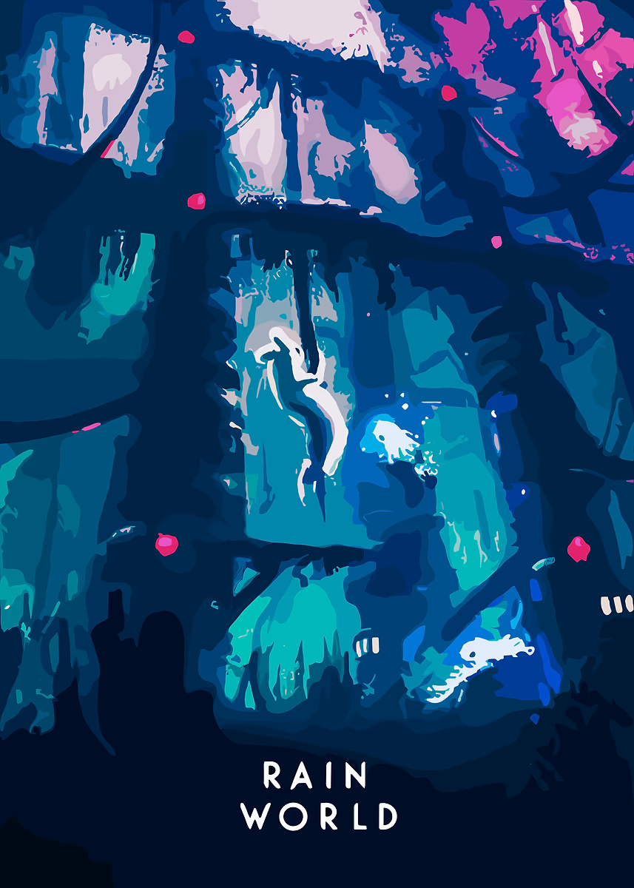

# Concept

Versatile portfolio project than can be used for both resume, and YouTube/X. Design language will be used in YouTube videos. 

## Design Concept:
- I love this image: 

  

  - Rounded sans font. Pink heading, white text. 
  - blue and pink bg.
  - after the above the fold, navy bg, light blue panes, maybe alternative with sky pink. 
- Can i get away with addding a music toggle? or too kitsch 
- Include about, skills, my best work, favorite movies, favorite video games, contact. 
- An accessability toggle top right for color 

Projects in prod with images and cta
projects ive made with repo with images
favorite media 
bottom about: birthday, skills technical and product and applied ai and x and letterboxd

doma: 

huntsman's dawn 

youtube channel 

Gr0ve (formerly lumeforms): my first startup. Naturally, deeply embarrassing to reminisce over. Transformed open-text feedback into context aware and actionable business intelligence, or, was basically a opinionated Typeform competitor. Good riddance (time of your life). 

peek a bit above the fold to singal to scroll downwards. add the links.

solicit free lance? "Would love to contribute..."

find like 30 royalty free songs, make it so a new one plays each day in sequence. 
